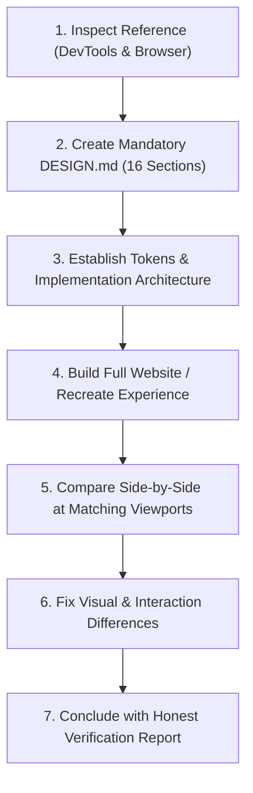

# Pure SaaS Reference Analysis & Deep Inspection Guide

This guide defines the engineering and design standard for `/pure-saas reference <url>`. It instructs AI coding agents to perform deep technical and visual inspection of reference websites using browser DevTools, author a comprehensive 16-section `DESIGN.md` specification, and recreate the reference's design language and interaction patterns for the user's product.

---

## 1. Core Principles

1. **Deconstruct Craft, Never Copy Assets:** Analyze the technical mechanics, visual hierarchy, spacing rhythms, typography ratios, and animation curves. Translate these principles into an original implementation tailored to the user's product identity. Never copy brand logos, proprietary copywriting, or copyrighted artwork.
2. **Mandatory Specification Before Code:** Never begin writing markup, components, or styles until a root-level `DESIGN.md` containing all 16 specification sections is authored and validated.
3. **Evidence-Based DevTools Inspection:** Trace computed styles, layout boxes, keyframe curves, network payloads, and DOM trees. Clearly separate measured values from inferred estimates and unknowns.
4. **Preserve Architecture & APIs:** In an existing codebase, recreate visual and interaction patterns without breaking existing backend routes, database contracts, authentication, or component interfaces.

---

## 2. Deep Reference Inspection: Browser DevTools

When a reference URL is provided, perform an exhaustive technical and visual inspection across 6 key areas before writing code:

### 1. Rendered Page & DevTools Console
- Open the live URL in a real browser using available automation or browser tooling.
- Inspect the rendered page, console messages, network activity, loaded stylesheets, and scripts.
- Check document mode, doctype, and rendering performance.

### 2. HTML & DOM Architecture
- Inspect the live rendered DOM tree rather than relying solely on the raw initial HTML payload.
- Identify the root semantic elements (`<header>`, `<main>`, `<section>`, `<nav>`, `<footer>`).
- Identify section boundaries, nesting depth, and reusable component hierarchies.
- Examine layout wrappers, grid containers, and responsive markup structures.

### 3. CSS in Depth & Computed Styles
- Inspect applicable CSS rules, computed styles, and custom property declarations (`--*`).
- Measure exact values:
  - **Typography:** font families, font weights, font sizes, line heights, letter-spacing tracking, and heading hierarchies.
  - **Colors:** canvas backgrounds, surface elevations, text colors, muted text, action accents, border colors, and gradients.
  - **Dimensions & Spacing:** container max-widths, section vertical padding, element margins, gap values, and gutter dimensions.
  - **Geometry:** border-radius curves, border widths, box shadows, backdrop filters, and layer opacity.
  - **Layout Engines:** CSS Grid columns/rows, Flexbox alignments, sticky positioning offsets (`top: 0`), and overflow clipping.

### 4. JavaScript, Motion & Dynamic Behaviour
- Identify relevant UI libraries and runtime frameworks (e.g., Framer Motion, GSAP, Tailwind, Radix).
- Observe animations in motion:
  - Entrance reveals: triggers, directions, translation distances (px/rem), durations (ms), delays, and cubic-bezier easing curves.
  - Scroll-triggered effects: pinned sticky headers, parallax offsets, scroll progress indicators, and replay behavior when scrolling back.
  - Dynamic interactions: accordion expands, dropdown menus, tab switching, modal dialogs, and toast notices.
  - Micro-interactions: button hover lifts, active press scales, and focus-visible rings.
  - Reduced-motion fallbacks: check `@media (prefers-reduced-motion: reduce)`.

### 5. Assets & Network Resources
- Inspect publicly loaded assets: font files (WOFF2/TTF), SVGs, raster images (WebP/AVIF), video files, and vector icons.
- Record source dimensions, aspect ratios, intrinsic sizes, and intended design roles.
- **Asset reuse rule:** Use assets only when legally permitted and appropriate (e.g., standard public icons); otherwise create original SVG or CSS equivalents that preserve visual fidelity.

### 6. Responsive Ergonomics & Breakpoints
- Test viewports at desktop (1440px / 1280px), tablet (768px), and mobile (375px).
- Observe breakpoint triggers, container padding collapse, column stacking, mobile navigation drawers, and touch target adjustments (minimum 44x44px).

---

## 3. Mandatory 16-Section `DESIGN.md` Specification

Before implementing or modifying code, author or update `DESIGN.md` at the project root covering these 16 implementation-ready sections:

1. **Reference Overview:** Source URL, inspection date, pages inspected, viewport sizes tested, inspection tools used, observed limitations, and confidence level.
2. **Design Direction:** Aesthetic archetype (e.g. Technical Terminal, Editorial Serif, Swiss Modern), visual identity, brand personality, design principles, and visual hierarchy.
3. **Page Architecture:** Every section in order, its specific purpose, content hierarchy, background treatment, layout dimensions, padding, and transitions between sections.
4. **Layout System:** Container widths, max widths, page margins, grid columns, gutters, alignment rules, flexbox configurations, sticky elements, and overflow behavior.
5. **Spacing System:** Measured and inferred spacing scale for sections, containers, headings, body copy, buttons, and cards. Distinguish measured values from estimates.
6. **Colour System:** Semantic color architecture with hex/rgb values and CSS variable definitions (`--color-bg-canvas`, `--color-bg-surface`, `--color-text-primary`, `--color-text-secondary`, `--color-action-primary`, `--color-border-subtle`, `--color-status-*`).
7. **Typography:** Font families, weights, sources, display/heading/body sizes, line heights, letter-spacing tracking, responsive scaling, and measure restrictions (45–75 characters).
8. **Component Inventory:** Navigation bar, hero section, buttons, cards, feature sections, media frames, badges, forms, dropdowns, dialogs, footer, and other components with dimensions, padding, radii, borders, shadows, and states.
9. **Assets:** Images, SVGs, icons, videos, textures, illustrations, and webfonts with formats, dimensions, aspect ratios, intended roles, and reuse status.
10. **Motion and Interaction:** Animation triggers, durations, stagger delays, easing curves, transforms, transitions, scroll effects, sticky behavior, hover/focus/active states, and reduced-motion fallback.
11. **Responsive Behaviour:** Desktop, tablet, and mobile layouts, observed breakpoints, navigation drawer collapse, stacking rules, visibility changes, and touch adaptations.
12. **Technical Observations:** DOM hierarchy, semantic HTML elements, CSS custom properties, pseudo-elements, JavaScript behavior, and dependencies.
13. **Design Tokens:** Complete token specification in frontmatter and CSS custom properties covering colors, spacing, typography, radii, shadows, and breakpoints.
14. **Implementation Architecture:** Component tree, file structure, reusable component breakdown, styling approach (CSS Modules, Tailwind, or Vanilla CSS), and asset organization.
15. **Accessibility and States:** Keyboard navigation, visible focus rings, contrast compliance (WCAG 2.2 AA), semantic landmarks, alt text, form validation, and interaction states (`hover`, `focus-visible`, `active`, `disabled`, `loading`, `empty`, `error`, `success`).
16. **Implementation Checklist:** Actionable checklist covering every section, component, responsive state, interaction, animation, and visual polish item that must be implemented and verified.

---

## 4. Confidence & Provenance Model

Every value in the reference record and design specification must be classified:
- **Measured:** Directly extracted from DOM elements, computed CSS styles, or network responses.
- **Estimated:** Inferred visually from rendered layouts, screenshots, or screen recordings where DevTools inspection was constrained.
- **Unknown:** Could not be verified (e.g., hidden states, authenticated portals, unavailable mobile viewports).

Never fabricate inspection data. If a property or state cannot be inspected, record it as `unknown` and supply a standard fallback.

---

## 5. Required Execution Order

When `/pure-saas reference <url>` is triggered, execute in strict sequence:

1. **Inspect the Reference:** Run deep browser DevTools inspection across DOM, styles, motion, network, and responsive viewports.
2. **Create `DESIGN.md`:** Author the 16-section implementation-ready specification in `DESIGN.md`. Validate with `node scripts/pure-saas.mjs validate DESIGN.md`.
3. **Establish Tokens & Architecture:** Export tokens to CSS or framework config, map components, and plan directory layout.
4. **Build Full Website:** Recreate the experience with clean, reusable components, authentic copy for the user's product, responsive layouts, and accessible interaction states.
5. **Compare & Refine:** Run locally and compare side-by-side at 1440px, 768px, and 375px viewports.
6. **Fix Differences:** Correct discrepancies in typography, alignment, whitespace, animation curves, and states. Update `DESIGN.md` with verified final decisions.
7. **Report:** Conclude with an honest ledger of what was inspected, implemented, verified, and left unverified.
